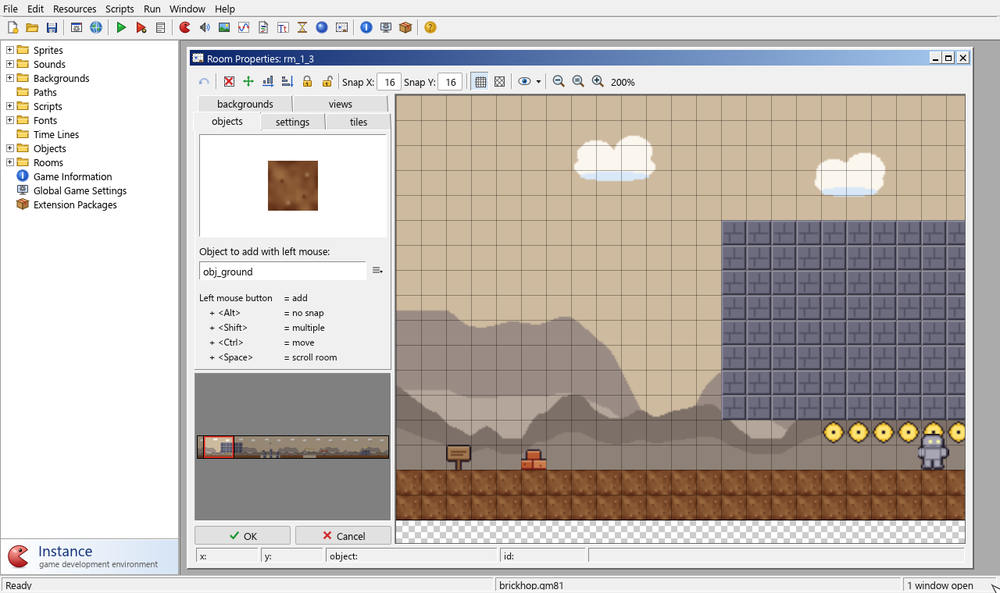
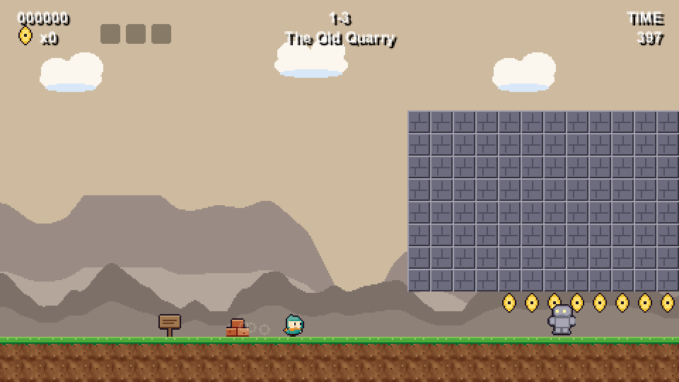
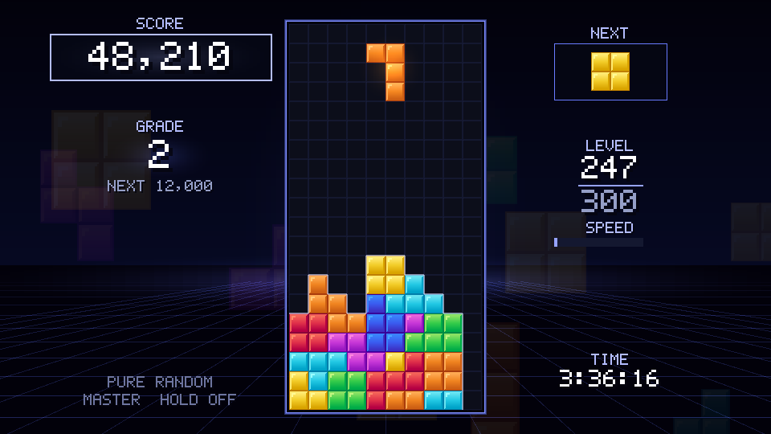
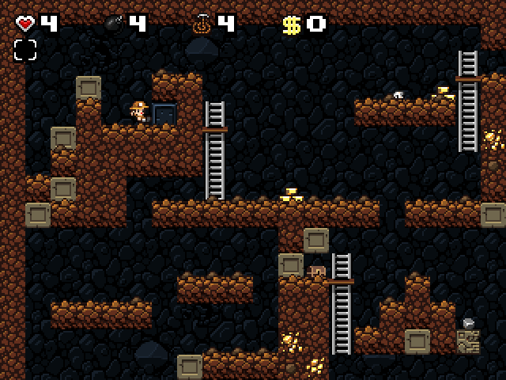

<h1 align="center">Instance</h1>

<p align="center">
  An open-source game development environment: a visual editor and a game engine for <code>.gmk</code> and <code>.gm81</code> projects.
</p>

<p align="center">
  <a href="https://groverburger.github.io/instance/"><b>Try it in your browser</b></a> ·
  <a href="https://github.com/groverburger/instance/releases">Download</a> ·
  <a href="docs/manual/README.md">Manual</a>
</p>

<p align="center">
  <a href="https://github.com/groverburger/instance/actions/workflows/ci.yml"></a>
  <a href="https://github.com/groverburger/instance/actions/workflows/pages.yml"></a>
</p>

<p align="center">
  
</p>

Instance is a classic 2D game creation tool, written from scratch in Rust. You build games
from sprites, objects, events and rooms, with drag-and-drop actions or the GML
scripting language. It opens existing `.gmk` and `.gm81` projects and plays them the
way you remember, on Windows, macOS, Linux and in the browser.

Older games rely on all kinds of engine quirks: the order events run in, the exact
random number generator, how `sound_isplaying` lags behind the audio. Instance
reproduces them faithfully, checked with black-box tests.

## Try it in your browser

The [web version](https://groverburger.github.io/instance/) is the whole IDE and player,
compiled to WebAssembly. It opens with three example games: pick one, change it, and
press Run. Click a screenshot to play that game.

<p align="center">
  <a href="https://groverburger.github.io/instance/play.html?game=examples/brickhop.gm81"></a>
  <a href="https://groverburger.github.io/instance/play.html?game=examples/gravity_grade.gm81"></a>
  <a href="https://groverburger.github.io/instance/play.html?game=examples/spelunky.gm81"></a>
</p>

- **Brickhop**, a platformer: open a level in the room editor, move some bricks and play
  your version.
- **Gravity Grade**, a falling-block game written in GML.
- **Spelunky Classic**, Derek Yu's 2008 game, from the source he released in 2009.

Your work is autosaved in the browser; File > Save downloads it as a `.gm81`.

## Features

- **The full IDE**: sprite, sound, background, path, script, font, timeline, object
  and room editors, plus an image editor, a debug mode and an Output Log.
- **The full runtime**: GML, drag-and-drop actions, views, paths, particles,
  surfaces, 3D (`d3d_*`), MIDI and sound effects, joysticks, extension packages and
  DLLs.
- **Hardware-accelerated** OpenGL rendering, with a software renderer as a fallback.
- **Create Executable** builds a standalone game, and **Export Web Page** saves it as
  one `.html` file that plays in any browser.
- **Multiplayer** (`mplay_*`) over TCP/IP.
- **Runs in the browser**: the whole IDE and player, compiled to WebAssembly.
- **Project folders**: a project can be kept as plain text and PNG files, ready for
  git, and converted back to a `.gm81` without losing anything.
- **Imports `.gmx` / `.gmz` projects** from later engine versions with `gmx2gm81`.

## Getting started

Grab a build from the [releases page](https://github.com/groverburger/instance/releases),
or use the [web version](https://groverburger.github.io/instance/) without installing
anything.

To build from source, install [Rust](https://rustup.rs) and run:

```sh
git clone https://github.com/groverburger/instance
cd instance
cargo build --release
```

Then start the IDE, or play a game directly:

```sh
target/release/instance-ide                     # the editor
target/release/instance-runner game.gm81        # play a game
target/release/instance-runner game.gm81 --debug
```

On Linux you'll need the ALSA, udev, X11/Wayland and GL development packages first.
The [manual](docs/manual/README.md) explains how to make games, from a first tutorial
to the full function reference; it is also built into the IDE (Help > Contents, or
F1). The [reference](docs/reference.md) covers the rest: command-line tools, the headless
test harness, the web build, DLLs and platform notes.

## Clean-room implementation

Instance is an independent implementation. Its behaviour is written up in
[`specs/`](specs) from documentation, project file data and black-box observation,
and the code is written from those specs; no existing engine code was disassembled,
decompiled or copied. [CLEANROOM.md](CLEANROOM.md) describes the process.

## Project layout

| Crate | What it does |
|---|---|
| `gml` | GML lexer, parser, compiler and interpreter |
| `instance-runner` | the game engine |
| `instance-ide` | the editor |
| `instance-format` | reading and writing `.gmk` / `.gm81` files and project folders |
| `instance-check` | `gmk-check`, a static checker for projects |
| `instance-gmx` | the `.gmx` / `.gmz` project converter |
| `instance-net` | multiplayer |
| `instance-dllcall`, `instance-dllhost32` | calling native DLLs, including 32-bit ones |
| `instance-blackbox` | black-box test projects for checking compatibility |

Tools and example games for *making* games with Instance live in the separate
`instance-gamekit` repository.

## License

Instance is released under the [MIT License](LICENSE). The bundled fonts keep their
own licenses (Liberation Sans: SIL Open Font License; Roboto: Apache 2.0).

The example games are in [`web/examples`](web/examples). Brickhop and Gravity Grade were
made with [`instance-gamekit`](https://github.com/groverburger/instance-gamekit).
Spelunky Classic is not covered by Instance's license: it is © 2008, 2009 Derek Yu and
Mossmouth, LLC, shared under the
[Spelunky User License v1.1b](web/examples/spelunky-COPYING.txt). The copy here is a mod
of the original source: its sound goes through GameMaker's built-in sound functions
instead of `supersound.dll`, so it runs without a DLL and in the browser
([`scripts/build-spelunky-mod.py`](scripts/build-spelunky-mod.py) makes it). Instance is
not affiliated with Mossmouth or with YoYo Games.
