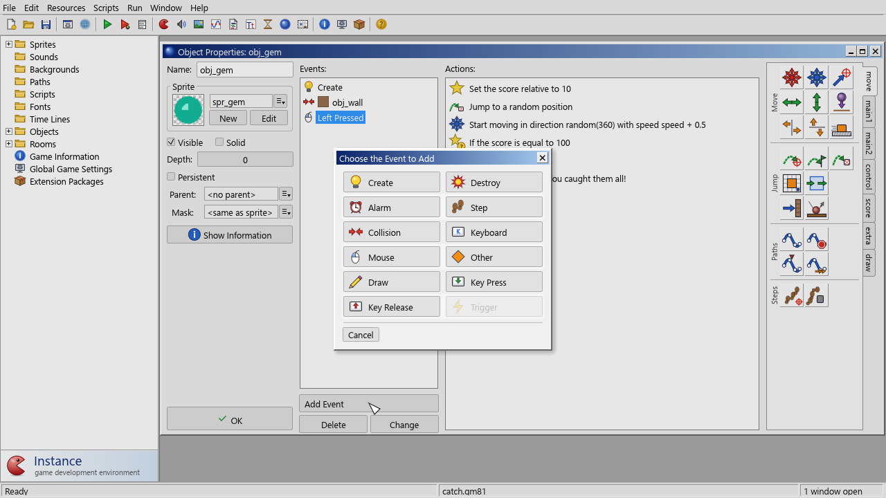

# Objects

An **object** defines a kind of thing in your game: what it looks like, and how it
behaves. The behaviour is a set of **events**, each with a list of **actions**. In a
running game, every instance of the object reacts to those events by running those
actions.

Create an object with **Resources > Create Object** and double-click it in the tree
to open the **Object Properties** form.

The form has four columns: the object's properties, the **Events** list, the
**Actions** list of the selected event, and the action palette.

## Properties

| Field | What it does |
|---|---|
| Name | The name you use in actions and code, for example in `instance_create(x, y, obj_bullet)`. |
| Sprite | The sprite the object is drawn with and, normally, collides with. Choose `<no sprite>` for invisible helper objects. |
| New | Creates a new sprite, opens it, and gives it to this object. |
| Edit | Opens the selected sprite. |
| Visible | Whether instances are drawn. Invisible instances still run their events and collide; only drawing (and the Draw event) is skipped. |
| Solid | Marks instances as solid, for walls and floors. When an instance has a collision event with a solid instance, both are put back where they were before the step's movement before the event runs, so they don't end up inside each other. Actions such as Bounce, Move to Contact and Check Empty also look at solidity. |
| Depth | The drawing order. Instances with a higher depth are drawn first, so lower (or negative) depths appear in front. The default is 0. |
| Persistent | Persistent instances survive room changes: they come along to the next room instead of being removed. |
| Parent | Another object to inherit from. See [Parents](#parents). |
| Mask | A sprite to use for collisions instead of the object's own sprite. `<same as sprite>` uses the object's sprite. |
| Show Information | Shows a text summary of the object: its properties, its parent and children, and all events with their actions. You can select and copy the text. |
| OK | Applies your changes and closes the form. |

The object form has no Cancel button. To throw away your changes, close the form with
its **×** button (or press Escape) and answer **No** when asked whether to save.

## Events

The **Events** list shows the events the object reacts to, sorted by kind. A collision
event shows the other object's name and sprite. Select an event to see and edit its
actions.

| Button | What it does |
|---|---|
| Add Event | Opens the event selector to add an event. If the object already has that event, it's selected. |
| Delete | Deletes the selected event and its actions. If the event has actions, you are asked first. |
| Change | Moves the actions of the selected event to a different event. |

The same commands are in the right-click menu of the list (**Add Event…**, **Change
Event…**, **Delete Event**).

### The event selector

**Choose the Event to Add** shows a button for each kind of event:

- **Create**, **Destroy** and **Draw** are added directly.
- **Alarm**, **Step**, **Collision**, **Keyboard**, **Mouse**, **Other**,
  **Key Press** and **Key Release** open a menu to choose the exact event: which alarm,
  which object to collide with, which key, and so on.
- **Trigger** lists the [triggers](constants-triggers-files.md#triggers) defined in the
  project. It's disabled when there are none.

[Events](events.md) describes every event and when it happens.

An event you add but leave without actions is dropped when you press OK.

## The action list

The **Actions** list shows the actions of the selected event, top to bottom, in the
order they run. Each line shows the action's icon and a description with its
settings, such as *Set the score relative to 10*. Actions between **Start Block** and
**End Block** are indented. Hover over a long line to read all of it.

### Adding actions

- **Drag** an action from the palette into the list. A line shows where it will go.
- Or **click** an action in the palette: it's added after the selected action, or at
  the end if none is selected.

If the action has settings, its window opens straight away. Pressing **Cancel** in
that first window removes the new action again.

### Editing actions

| To… | Do this |
|---|---|
| Change an action's settings | Double-click it, or right-click and choose **Edit Values…** |
| Move an action | Drag it up or down in the list |
| Delete an action | Select it and press Delete, or right-click > **Delete** |
| Copy actions between events or objects | Select, Ctrl+C (or right-click > **Copy**), select the target, Ctrl+V. Pasted actions go after the selected one. |
| Remove all actions of the event | Right-click > **Clear** |
| Select the next or previous action | Down or Up arrow key |

The action clipboard is shared by all object and time line forms, so you can copy an
action from one object and paste it into another.

## The action palette

The palette on the right holds all available actions, grouped into tabs. The tabs run
down the right edge: **move**, **main1**, **main2**, **control**, **score**, **extra**
and **draw**. Within a tab, actions are arranged in labelled sections. Hover over an
action to see its name and a short description.

[Actions](actions.md) lists every action on every tab.

## The action window

Each action with settings has a window with:

- **Applies to** (for actions that can act on other instances):
  - **Self**: the instance running the event.
  - **Other**: the other instance in a collision event (or the instance that ran a
    `with` block).
  - **Object**: every instance of the chosen object. For example, a Destroy Instance
    that applies to `obj_enemy` destroys all enemies.
- The action's **settings**. Each kind of setting has its own control:
  - numbers and expressions: a text field accepting any GML expression, such as
    `x + 32`, `random(10)` or `global.level * 2`;
  - text: a text field (some text fields also accept expressions, for example
    `"Score: " + string(score)`);
  - true/false and fixed choices: a drop-down list;
  - resources (sprites, sounds, objects, rooms and so on): a resource picker;
  - colours: a colour box.
- **Relative** (for actions that set a value): adds the value to the current one
  instead of replacing it. A Jump to Position of (4, 0) with Relative ticked moves the
  instance 4 pixels to the right.
- **NOT** (for questions): reverses the question's answer.

Some actions have a special window:

- **Move Fixed** shows nine arrow buttons. Switch on one or more directions (or the
  centre square for "stop"); if several are on, one is chosen at random each time the
  action runs.
- **Execute Code** opens the [code editor](scripts.md#the-code-editor).
- **Start Block**, **End Block**, **Else**, **Exit Event** and **Call Parent Event**
  have no settings and no window.

## Parents

An object with a **parent** behaves as if it had all of the parent's events and
actions. If it defines an event itself, its own version replaces the parent's for that
event. To run the parent's version as well, put the **Call Parent Event** action (or
`event_inherited()`) in the child's event.

Children also count as their parent in collisions, tests and actions that apply to an
object. A collision event with `obj_enemy` also happens with instances of every child
of `obj_enemy`. That makes parents ideal for families of similar objects: give
`obj_enemy` the shared behaviour, and make `obj_bat`, `obj_slime` and `obj_ghost` its
children.

An object can't be its own ancestor: Instance refuses a parent that would create a
loop. See [Instances, objects and parenting](../runtime/instances.md).

See also: [Events](events.md) · [Actions](actions.md) · [Core ideas](../intro/concepts.md) · [Movement and collisions](../runtime/movement-and-collisions.md)
