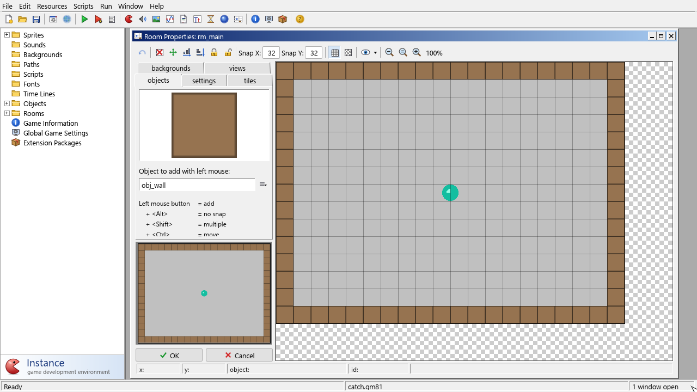

# Rooms

A **room** is a place where your game happens: a level, a title screen, a menu, a
game-over screen. In the room editor you set the room's size and speed, choose its
backgrounds, place instances of objects and tiles, and set up views.

Create a room with **Resources > Create Room** and double-click it in the tree to
open the **Room Properties** form. The game starts in the first room of the
resource tree; drag rooms in the tree to change their order.

## The room form

The form has:

- a **toolbar** along the top;
- on the left, the **tabs** (objects, settings, tiles in one row; backgrounds and views
  in the other), a small **room preview** (the whole room in miniature, with a frame
  around the part you see; click or drag in it to scroll), and the **OK** and
  **Cancel** buttons;
- the **room canvas** on the right, where you place things;
- a **status bar** at the bottom showing the mouse position in the room (snapped to
  the grid) and the instance under the mouse.

### Moving around the canvas

| To… | Do this |
|---|---|
| Zoom | Turn the mouse wheel, or use the zoom buttons in the toolbar |
| Scroll | Drag with the middle mouse button, or hold Space and drag with the left button |
| Jump to a part of the room | Click in the room preview |

### The toolbar

| Button | What it does |
|---|---|
| Undo | Undoes the last change. |
| Clear all | Deletes all instances (on the tiles tab: all tiles of the current layer). Locked ones are deleted too. |
| Shift all | Moves all instances (or tiles) by an amount you enter. |
| Sort by x, Sort by y | Reorders the instances by their position. The order matters because instances are created, and run their events, in this order. |
| Lock all, Unlock all | Locks or unlocks all instances (or tiles). Locked items can't be moved or deleted with the mouse. |
| Snap X, Snap Y | The grid size that placed and moved items snap to. |
| Grid | Shows or hides the grid. |
| Isometric grid | Shows a diamond-shaped grid, for isometric games. |
| Show | A menu to show or hide Objects, Tiles, Backgrounds, Foregrounds and Views while editing. This only affects the editor. |
| Zoom out, Normal size, Zoom in | Change the zoom. The zoom level is shown next to them. |

## The objects tab

This is where you place instances.

1. Choose the object under **Object to add with left mouse**. A large picture of its
   sprite is shown above.
2. Click in the room to add an instance at the mouse position, snapped to the grid.
   Keep the button down to drag the new instance into place.

| Mouse | Effect |
|---|---|
| Left click | Add an instance |
| + Alt | …without snapping to the grid |
| + Shift (drag) | Add instances all along the way, one per grid cell |
| + Ctrl (drag) | Move an existing instance |
| + Space (drag) | Scroll the room |
| Right click | Open the menu of the instance under the mouse |
| + Shift | Delete all instances at that position |
| + Ctrl | Delete the instance under the mouse |

With **Delete underlying** ticked, adding an instance first removes any instance at
exactly the same position, so you can paint over existing ones.

When instances overlap, the mouse picks the one drawn in front (the lowest depth).

### The instance menu

Right-click an instance for:

| Command | What it does |
|---|---|
| Delete | Deletes the instance (not available while it's locked). |
| Change position… | Type an exact x and y. |
| Move to front, Move to back | Makes it the last (front) or first (back) instance in the creation order. Among instances with the same depth, later ones are drawn on top. |
| Lock, Unlock | Locks the instance so it can't be moved or deleted by accident. |
| Creation code… | Code that runs for this one instance when it's created, just before its Create event. Use it to give one instance different settings, for example `door_target = rm_level2;`. |
| Edit object | Opens the instance's object. |

Instances of objects without a sprite are shown as a placeholder icon.

## The settings tab

| Setting | What it does |
|---|---|
| Name | The room's name. |
| Caption | The text in the game window's title bar while this room runs. The score, lives and health are added to it if they are shown (see the Score Caption action). |
| Width, Height | The room size in pixels. 640×480 by default. |
| Speed | Steps per second. 30 by default. All movement and timing is per step, so this is the speed of the game in this room. |
| Persistent | A persistent room remembers its state: when you come back, it's exactly as you left it, instead of starting fresh. |
| Creation code… | Code that runs once when the room starts, after the Create events of its instances and before their Room Start events. |

## The tiles tab

Tiles are small pieces of a background image placed in the room, for building scenery
cheaply. They have no events and don't collide. See
[Backgrounds: tile sets](backgrounds.md#tile-sets).

1. Choose a background under **Tile set**. Its image is shown, with the selected tile
   outlined in yellow. A background marked *Use as tile set* is divided according to
   its tile settings; otherwise the room's snap size is used.
2. Click a tile in the image to select it.
3. Click in the room to place it. The same mouse modifiers as on the objects tab
   apply: Alt for no snapping, Shift-drag to paint many, Ctrl-drag to move a tile.
   **Right-click a tile to delete it.**

Tiles live in **layers**, each with its own depth. Layers with a high depth are drawn
behind instances; give a layer a negative depth to draw it in front.

| Control | What it does |
|---|---|
| Current tile layer | The layer you are placing tiles in. Only tiles of this layer can be moved or deleted. The default layer has depth 1000000. |
| Add | Adds a new layer with a depth you enter. |
| Delete | Deletes the current layer and all its tiles (there must always be one layer). |
| Delete underlying | Placing a tile removes any tile at the same position in this layer. |

The tab also shows the total number of tiles in the room.

## The backgrounds tab

| Setting | What it does |
|---|---|
| Draw background color | Fills the room with a colour before drawing anything else. Choose the colour with the colour box. Untick it only if backgrounds cover the whole room. |
| Background 0 … Background 7 | The eight background slots. Slots that are visible when the room starts are shown in bold. Select one to edit it. |

For the selected slot:

| Setting | What it does |
|---|---|
| Visible when room starts | Whether this background is drawn. |
| Foreground image | Draws the image in front of the instances instead of behind them. |
| (background picker) | The background resource to use. |
| Tile Hor., Tile Vert. | Repeats the image to fill the room horizontally and/or vertically. |
| Stretch | Stretches the image to the size of the room. |
| X, Y | The position of the image. |
| Hor. Speed, Vert. Speed | Scrolls the image by this many pixels per step, for moving skies, water and parallax effects. |

## The views tab

A **view** shows part of the room in the game window. With views you can make rooms
bigger than the screen and scroll around them, or show several parts of the room at
once (split screen, a mini-map).

| Setting | What it does |
|---|---|
| Enable the use of Views | Switches views on for this room. |
| View 0 … View 7 | The eight views. Visible ones are shown in bold. Select one to edit it. |
| Visible when room starts | Whether this view is used. |
| View in room: X, Y, W, H | The area of the room the view shows. |
| Port on screen: X, Y, W, H | Where on the game window that area is drawn, and at what size. A port larger than the view area zooms in. |
| Object following | An object for the view to follow. The view scrolls to keep the first instance of that object inside it. |
| Hbor, Vbor | How close (in pixels) the followed instance may come to the edge of the view before the view scrolls. Large borders keep the instance near the middle. |
| Hsp, Vsp | The maximum scroll speed per step; -1 means the view jumps immediately. |

The game window is sized to fit the ports of the visible views.

> **Tip:** For a typical scrolling game, make the room large, enable views, set
> View 0 to 640×480 in the room and on screen, and let it follow the player with
> borders of about 200 and 150.

## Saving the room

Press **OK** to apply your changes, or **Cancel** to discard them. The toolbar's Undo
is your safety net while editing.

See also: [Rooms and views](../runtime/rooms-and-views.md) · [Objects](objects.md) · [Backgrounds](backgrounds.md) · [Events: Room Start](events.md#other)
