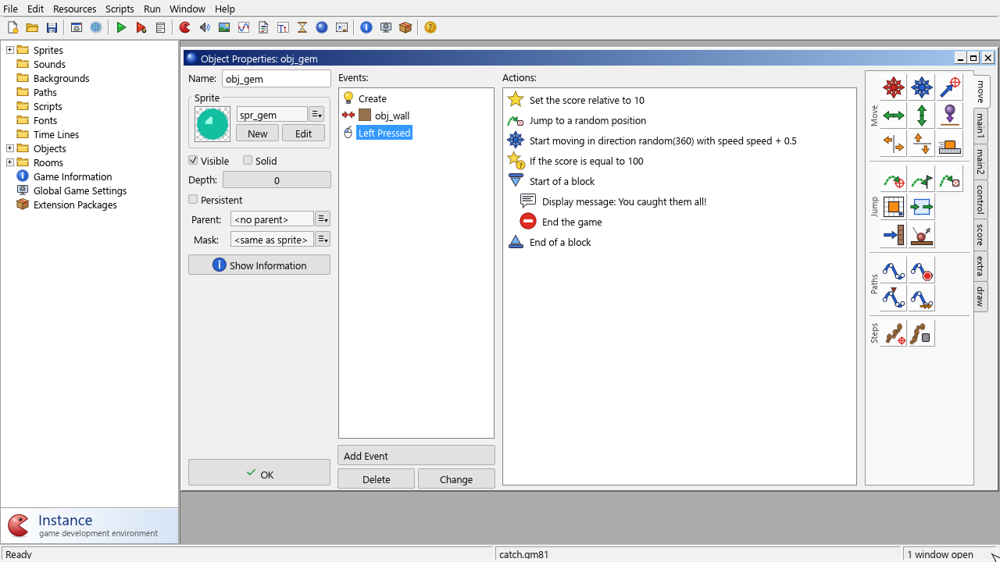

# Your first game

In this tutorial you build **Catch the Gem**: a gem bounces around a walled
playing field, and the player tries to click it. Every catch scores 10 points, sends
the gem somewhere else and makes it a little faster. At 100 points the player wins.

It takes about twenty minutes. You will use sprites, objects, events, actions and a
room, the building blocks of every game. First you build it entirely with
drag-and-drop actions; at the end you see the same game written in GML.

## Step 1: Start a new project

Start Instance. It opens with an empty project. (If something else is open, choose
**File > New**.) Save it right away with **File > Save As…** and call it
`catch.gm81`, so you can press **Ctrl+S** as you go.

## Step 2: Make the sprites

A sprite is the image of a thing. You need two: a gem and a piece of wall. You can
load images from PNG files, but it's just as quick to draw them.

**The wall:**

1. Choose **Resources > Create Sprite**. The sprite form opens.
2. In **Name**, type `spr_wall`.
3. Click **Edit Sprite…**. The sprite editor opens with no images yet.
4. Click **Add** in its toolbar. An empty 32×32 image appears.
5. Double-click the image. The image editor opens.
6. Click a colour in the palette on the right (a grey or brown works well for a wall).
   A left click picks the colour for the left mouse button.
7. Choose the **Fill** tool from the tool box on the left and click anywhere on the
   canvas. The whole square fills with your colour.
8. Click **Close Saving** in the image editor, then **Close Saving** in the sprite
   editor.
9. Press **OK** in the sprite form.

**The gem:**

1. Create another sprite and name it `spr_gem`.
2. Click **Edit Sprite…**, then **Add**, then double-click the new image.
3. Pick a bright colour, choose the **Ellipse** tool, and below the tool box choose the
   **Filled** variant.
4. Drag from the top-left corner of the canvas to the bottom-right corner. You get a
   filled circle.
5. Close both editors with **Close Saving**.
6. Back in the sprite form, click **Center** next to **Origin**, so the gem's position
   is the middle of the circle. Press **OK**.

> **Tip:** To use your own pictures instead, click **Load Sprite…** in the sprite
> form and choose a PNG, BMP, GIF or JPEG file. You can also drag an image file onto
> the main window to turn it into a new sprite.

## Step 3: Make the wall object

Sprites only look like something. To make things that exist in the game, you need
objects.

1. Choose **Resources > Create Object**. The object form opens.
2. Name it `obj_wall`.
3. In the **Sprite** box, click the picker and choose `spr_wall`.
4. Tick **Solid**. Solid objects are things others can bounce off.
5. Press **OK**.

The wall doesn't need to do anything, so it has no events.

## Step 4: Make the gem object

The gem needs behaviour. It should start moving when it appears, bounce off walls, and
react to the mouse.

1. Create an object named `obj_gem` and give it the sprite `spr_gem`.

**Start moving when created:**

2. Click **Add Event**. The **Choose the Event to Add** window opens. Click
   **Create**. The Create event appears in the **Events** list.
3. On the right of the form is the action palette, with tabs along its right edge.
   Open the **move** tab. Drag the **Move Free** action (hover over the buttons to see
   their names) into the **Actions** list.
4. The action's window opens. Set **direction** to `random(360)` and **speed** to
   `4`, then press **OK**.

`random(360)` is an expression: a random number between 0 and 360, so the gem starts
off in a random direction. Any field that takes a number also accepts an expression.

**Bounce off the walls:**

5. Click **Add Event**, click **Collision**, and choose `obj_wall` from the menu.
6. From the **move** tab, drag **Bounce** into the actions. Leave the settings as they
   are (not precisely, against solid objects) and press **OK**.

**React to a click:**

7. Click **Add Event**, click **Mouse** and choose **Left pressed**. This event happens
   when the player presses the left mouse button while the pointer is over the gem.
8. Open the **score** tab and drag in **Set Score**. Type `10` as the **new score**
   and tick **Relative**, so 10 is *added* to the score instead of replacing it. Press
   **OK**.
9. From the **move** tab, add **Jump to Random**. Press **OK** without changing
   anything. This moves the gem to a random free spot.
10. Add **Move Free** again, with **direction** `random(360)` and **speed**
    `speed + 0.5`. `speed` is the gem's current speed, so it gets faster after every
    catch.

**Win at 100 points:**

11. Still in the Left pressed event, open the **score** tab and add **Test Score**:
    **value** `100`, **operation** *equal to*. A test (also called a question) decides
    whether the next action runs.
12. Open the **control** tab and add **Start Block**. Then, from the **main2** tab,
    add **Display Message** with the message `You caught them all!`, and **End Game**.
    Finish with **End Block** from the **control** tab.

The block makes both actions depend on the test. Your action list now reads:

```
Set the score relative to 10
Jump to a random position
Start moving in direction random(360) with speed speed + 0.5
If the score is equal to 100
Start of a block
    Display message: You caught them all!
    End the game
End of a block
```



If an action landed in the wrong place,
drag it up or down, or select it and press Delete. Double-click an action to change
its settings. Press **OK** to close the object form.

## Step 5: Build the room

A room is where the game takes place. You place instances of your objects in it.

1. Choose **Resources > Create Room**.
2. On the **settings** tab, set **Name** to `rm_main` and **Caption** to
   `Catch the Gem`. The room is 640×480 pixels.
3. In the toolbar at the top, set **Snap X** and **Snap Y** to `32`, the size of a wall
   piece. New instances snap to this grid.
4. Go to the **objects** tab. Click the picker under **Object to add with left mouse**
   and choose `obj_wall`.
5. Click in the room to place a wall. To place a whole row, hold **Shift** and drag
   along the edge. Put walls along all four edges.
6. Made a mistake? Right-click an instance and choose **Delete**, or Ctrl+right-click
   to delete it directly. The toolbar's **Undo** button undoes the last change.
7. Choose `obj_gem` and click once in the middle of the room.
8. Press **OK**.


## Step 6: Play

Press **F5**. The game window opens, the gem flies off and bounces around. Click it!
Your score appears in the window caption. Press **Esc** to stop the game.

If something doesn't work, check that the gem's events and actions match the steps
above. If the game shows an error, read it in the error window and in the
**Output Log** (see [Running and debugging games](../ide/running-and-debugging.md)).

Don't forget to save (**Ctrl+S**).

## Ideas to try next

- Add a sound: create a sound resource, and put **Play Sound** (main1 tab) in the
  Left pressed event.
- Add a second gem to the room. Instances of the same object behave independently.
- Use an alarm to add a time limit: in a new controller object, **Set Alarm** in the
  Create event, and end the game in the **Alarm 0** event.
- Give the game a title in **Game Information**, which players see when they press F1.

## The same game in GML

Every action has a GML equivalent. Here is `obj_gem` again, this time with one
**Execute Code** action per event (control tab, **Code** section). Remove the other
actions from each event, drag **Execute Code** in, and type the code into the editor
that opens.

**Create** event:

```gml
direction = random(360);
speed = 4;
```

**Collision with obj_wall** event:

```gml
move_bounce_solid(false);
```

**Left pressed** event:

```gml
score += 10;
move_random(1, 1);
direction = random(360);
speed += 0.5;
if (score == 100) {
    show_message("You caught them all!");
    game_end();
}
```

The game plays exactly the same. Each line does the job of one action: `score += 10`
is Set Score with Relative ticked, `move_random(1, 1)` is Jump to Random, and so on.

### Moving code into a script

When the same code is needed in several places, put it in a script:

1. Choose **Resources > Create Script**, name it `scr_respawn`, and type:

   ```gml
   // Put the gem somewhere new and speed it up.
   move_random(1, 1);
   direction = random(360);
   speed += 0.5;
   ```

2. Press **OK**, and change the Left pressed code to:

   ```gml
   score += 10;
   scr_respawn();
   if (score == 100) {
       show_message("You caught them all!");
       game_end();
   }
   ```

A script runs as if its code were written where it's called, so `speed` and
`direction` still mean the gem's own variables. Scripts can also take arguments; see
[Functions and scripts](../gml/scripts.md).

## What you learned

- **Sprites** give objects their look.
- **Objects** have **events**, and each event has a list of **actions**.
- **Rooms** hold **instances** of objects; the game starts in the first room.
- Actions and **GML** do the same things; use whichever suits you.

Next, read [Core ideas](concepts.md) to understand how it all fits together.

See also: [Objects](../ide/objects.md) · [Events](../ide/events.md) · [Actions](../ide/actions.md) · [Rooms](../ide/rooms.md) · [GML overview](../gml/overview.md)
