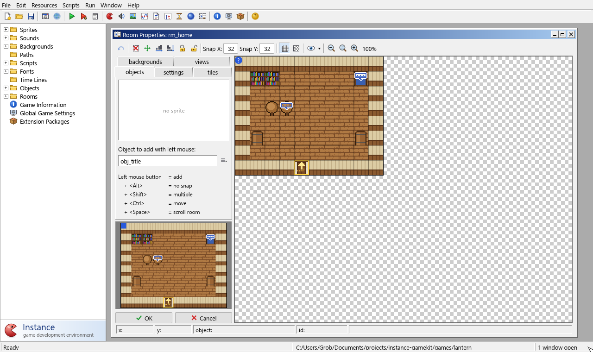

# A tour of the IDE

When you start Instance you see the main window. It has five parts:

1. **The menu bar** along the top: File, Edit, Resources, Scripts, Run, Window and
   Help.
2. **The toolbar** under it, with buttons for the most common commands.
3. **The resource tree** on the left, listing everything in your game.
4. **The workspace** on the right, where editors open as windows.
5. **The status bar** along the bottom, showing what just happened, the project file
   and how many windows are open.

## The resource tree

The tree has a folder for each kind of resource (Sprites, Sounds, Backgrounds, Paths,
Scripts, Fonts, Time Lines, Objects, Rooms) and three items for the game as a whole:
Game Information, Global Game Settings and Extension Packages.

- **Double-click** a resource to open its editor.
- **Right-click** for a menu with commands such as Create, Rename, Duplicate and
  Delete.
- **Drag** resources to reorder them or to move them into a group (a sub-folder).
  The order of rooms matters: the first room is where the game starts.

Sprites, backgrounds and objects show a small picture of their image in the tree.

## The toolbar

From left to right:

| Button | What it does |
|---|---|
| New, Open, Save | Start a new game, open one, save the current one |
| Create executable | Build a stand-alone program from the game |
| Publish | Not available |
| Run, Run in debug mode | Play the game (F5), or play it with the debugger (F6) |
| Output log | Show the messages of the last game run |
| Create sprite … room | Nine buttons that each add a new resource of one kind |
| Game information, Global game settings, Extension packages | Open these editors |
| About | Show the About box |

Hover over a button to see what it does.

## Editors in the workspace

Each resource opens in its own window inside the workspace, called a **form**. You can
have many forms open at once: drag them by the title bar, resize them by their edges,
and minimise or maximise them with the buttons in the title bar. Double-click a title
bar to maximise the form. **Window** menu commands tidy them up (Cascade, Arrange
Tiled, Minimise All, Close All) and list the open forms so you can bring one to the
front.

A form edits a working copy of the resource. Nothing changes in your game until you
press **OK**, which saves the changes into the project and closes the form. **Cancel**
throws the changes away. If you close a changed form with the **×** button (or
Escape), Instance asks whether to save the changes. A form with unsaved changes shows
a `*` after its title.

> **Tip:** Pressing OK in a form doesn't save the project to disk. Use **File > Save**
> (Ctrl+S) for that. The title bar of the main window shows a `*` while the project
> has unsaved changes.

## Running your game

Press **F5** or click the green Run button to play the game. Instance saves a
temporary copy of the project and starts the runner with it, so you don't have to
save first. While the game runs, its messages and any errors appear in the
**Output Log** (Window > Output Log). See
[Running and debugging games](../ide/running-and-debugging.md).

## Next steps

You know your way around. Now build [your first game](first-game.md).

See also: [The main window](../ide/main-window.md) · [Keyboard shortcuts](../ide/shortcuts.md)
